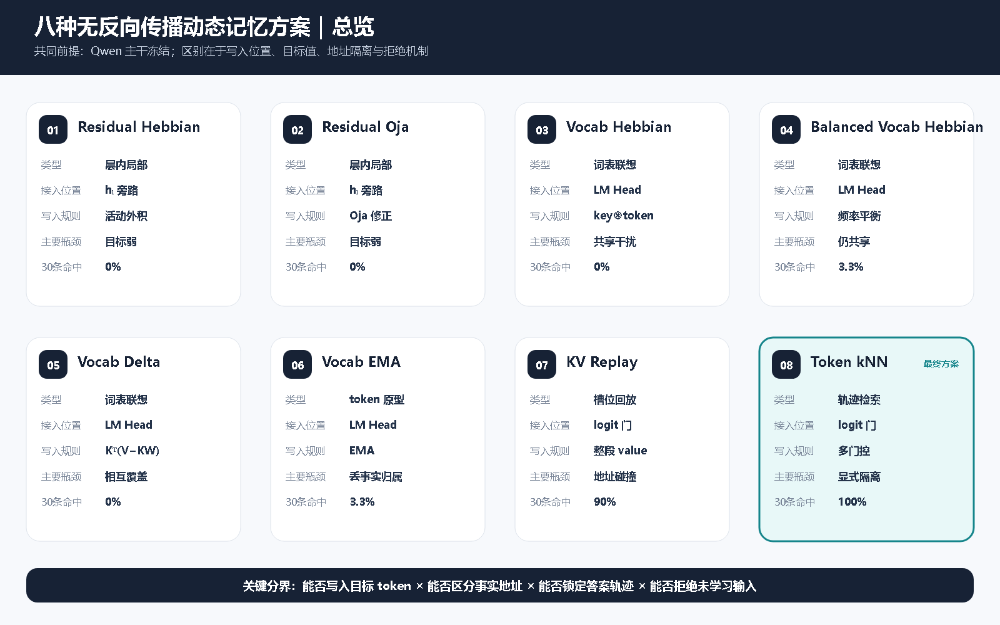
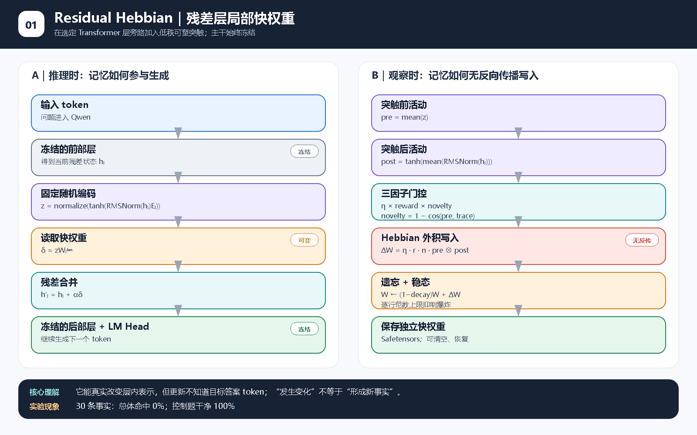
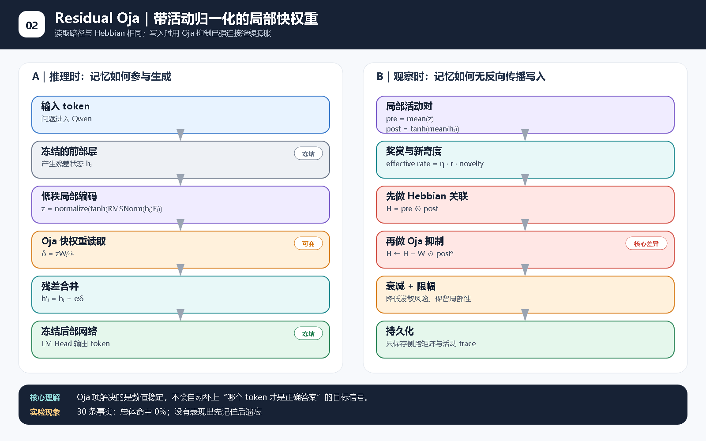
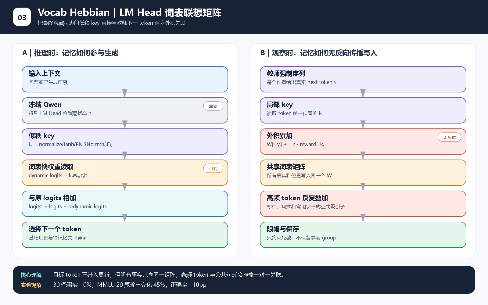
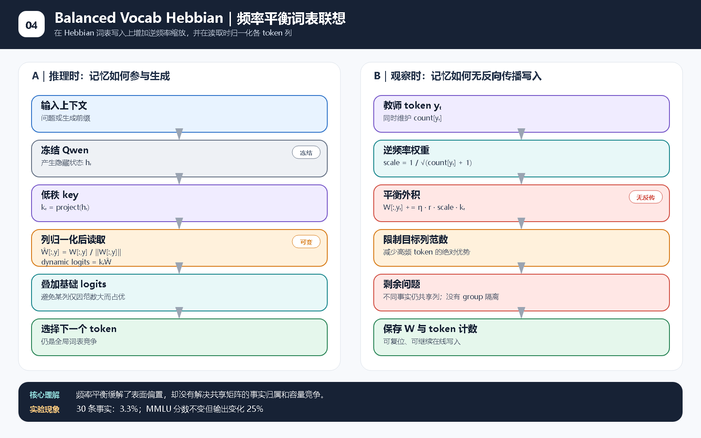
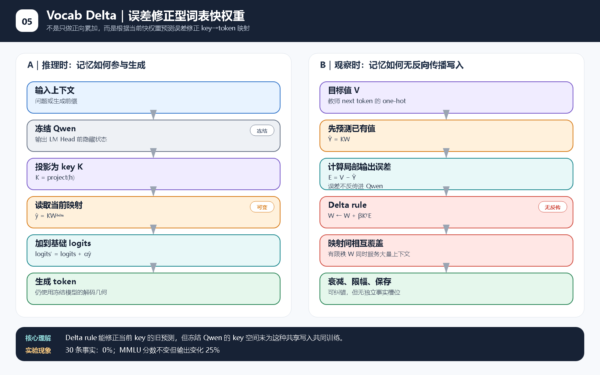
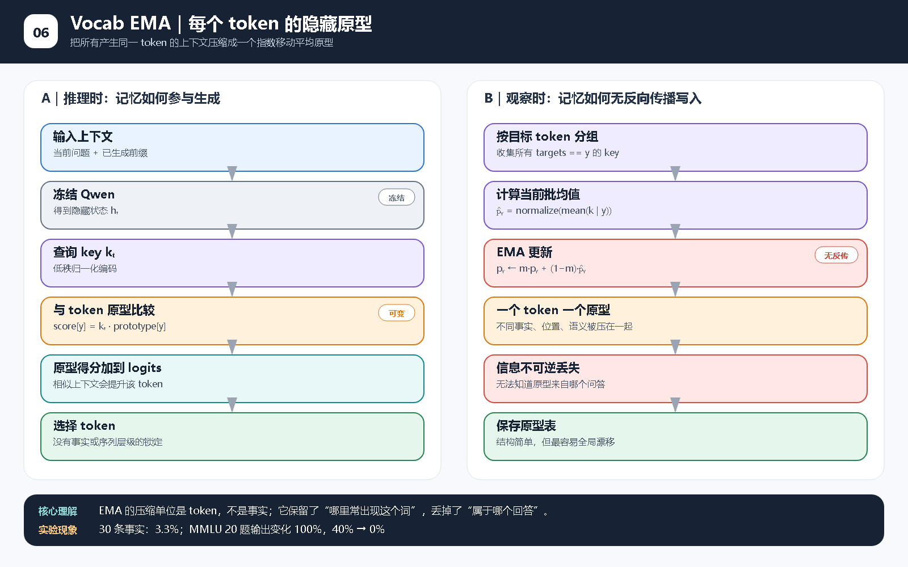
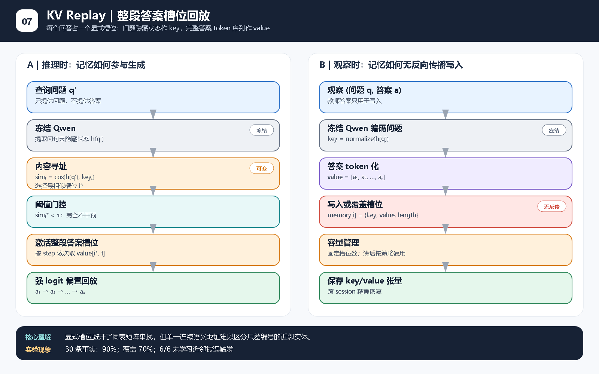
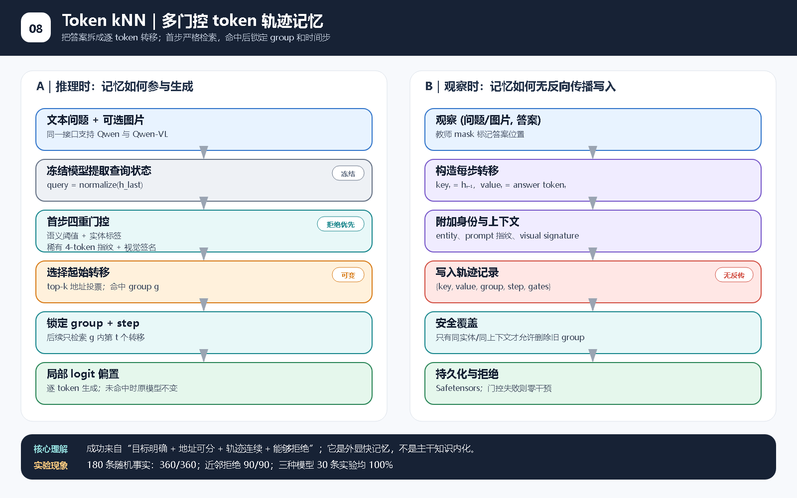

> **历史教师问答协议说明：** 本文的问答示例和成绩属于旧的人工 assistant 目标写入 / 回放实验，不能作为从 user 多轮对话形成记忆的结论。新实验仅观察 user 内容，并用独立进程评估；请以 [user 对话重新实验报告](user-dialogue-experiment-report.html) 为当前结论。

[← 返回交互实验台](../)

# 八种动态权重方案：架构图与运行示意

> 本页是快速理解版。需要查看每个 Decoder Layer 的 RMSNorm、QKV、RoPE/GQA、SwiGLU、残差计算，插件 hook 的精确位置，以及完整读写公式和张量形状，请看 [网络逐层计算与底层公式](layerwise-architecture-diagrams.html)。

每张图左侧是**推理读取路径**，右侧是**观察/教学时的无反向传播写入路径**。灰色模块表示冻结 Qwen；橙色表示持久化快权重；红色表示发生原位更新；青色表示检索或拒绝门控。

[打开可编辑 SVG 源文件](diagrams/00-overview.svg)

## 阅读顺序

1. 先看总览，理解方法从“层内局部相关”逐步走到“多门控显式轨迹记忆”；
2. 再看每张图左侧，跟随一次实际生成；
3. 最后看右侧，比较每种方法到底把什么作为 key、value 和更新目标。

## 01. Residual Hebbian｜残差层局部快权重

它只知道同一次前向的局部活动相关性，因此有生物启发性，却没有答案 token 这个明确目标。

[打开可编辑 SVG 源文件](diagrams/01-residual-hebbian.svg)

## 02. Residual Oja｜带活动归一化的局部快权重

它在 Hebbian 项上增加活动相关的负反馈，主要防止权重爆炸；稳定性提升不等于记忆目标对齐。

[打开可编辑 SVG 源文件](diagrams/02-residual-oja.svg)

## 03. Vocab Hebbian｜LM Head 词表联想矩阵

它第一次把教师 token 明确写进快权重，但所有事实挤在同一词表矩阵中，高频 token 会累积成公共吸引子。

[打开可编辑 SVG 源文件](diagrams/03-vocab-hebbian.svg)

## 04. Balanced Vocab Hebbian｜频率平衡词表联想

它降低高频 token 的写入强度并归一化读取列，缓解频率问题，但没有给每条事实独立身份。

[打开可编辑 SVG 源文件](diagrams/04-vocab-hebbian-balanced.svg)

## 05. Vocab Delta｜误差修正型词表快权重

它根据当前预测误差修正映射，比纯累加更聪明；不过冻结隐藏空间没有为共享 Delta 写入共同训练。

[打开可编辑 SVG 源文件](diagrams/05-vocab-delta.svg)

## 06. Vocab EMA｜每个 token 的隐藏原型

它为每个 token 保存一个平均上下文原型，压缩很强，也因此丢失了事实归属和答案位置。

[打开可编辑 SVG 源文件](diagrams/06-vocab-ema.svg)

## 07. KV Replay｜整段答案槽位回放

它把完整答案放进独立槽位，记忆成功率显著提高；问题是相似问句的连续地址会碰撞。

[打开可编辑 SVG 源文件](diagrams/07-kv-replay.svg)

## 08. Token kNN｜多门控 token 轨迹记忆

它把答案拆成 token 轨迹，并增加实体、词法、视觉和语义门控；只有首步确认身份后才锁定 group 继续生成。

[打开可编辑 SVG 源文件](diagrams/08-token-knn.svg)

## 一句话串起来

前两种方法只改变内部活动关联；中间四种开始面向输出 token，却把许多事实压进共享矩阵；KV replay 用独立槽位解决容量竞争；最终 token kNN 再补上身份门控、轨迹约束与未命中拒绝，才同时获得高召回和低污染。

这些图描述的是本项目实际代码，而不是对相关论文原始架构的逐图复刻。公式和实验边界见 [完整实验报告](comprehensive-experiment-report.html)。

