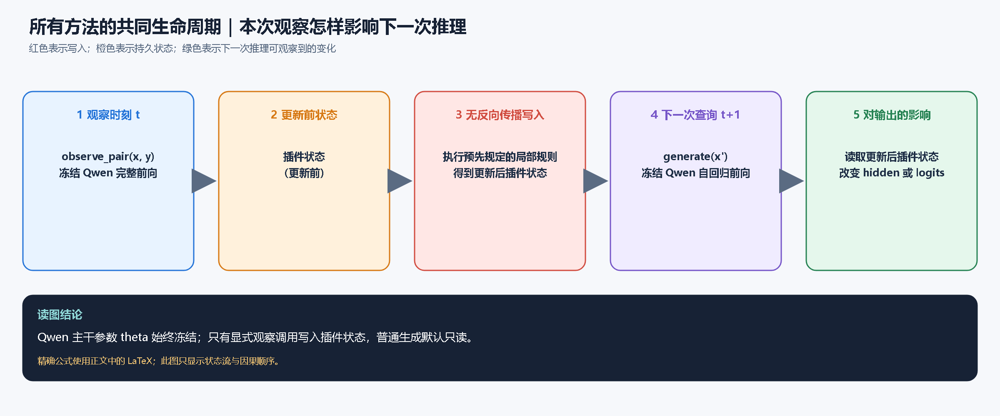
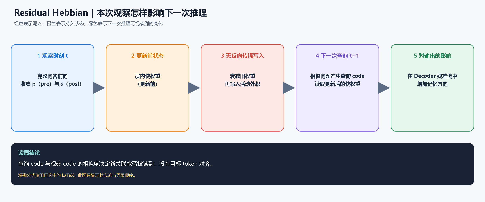
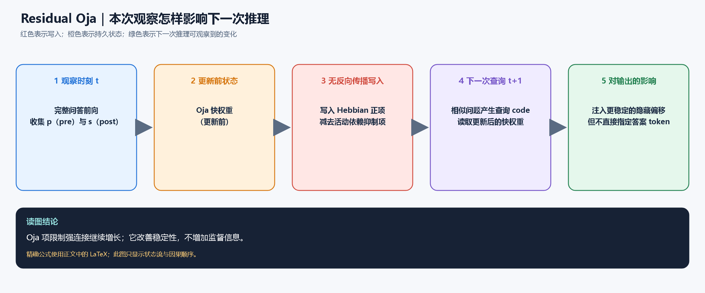
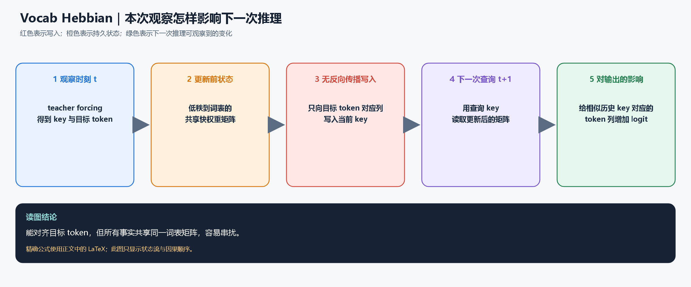
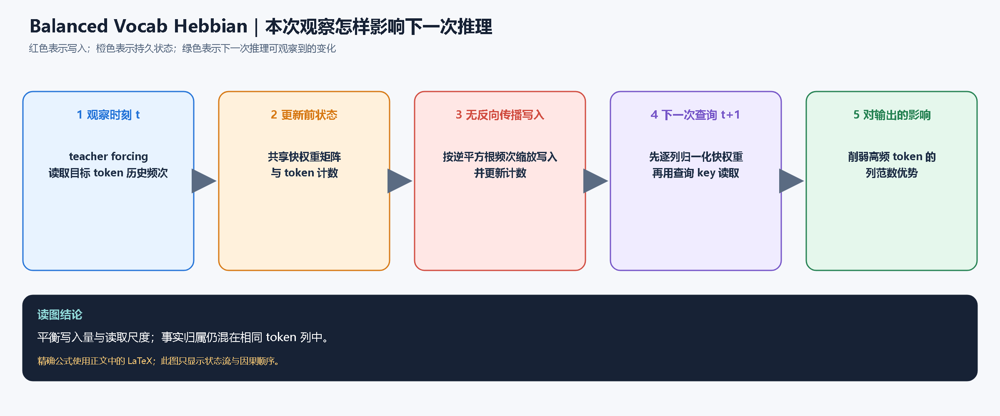
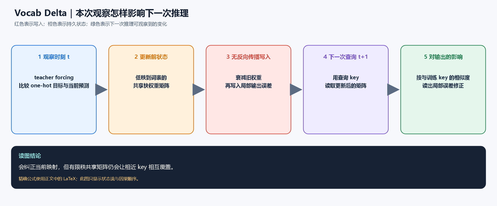
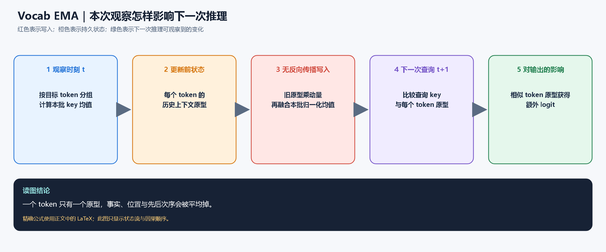
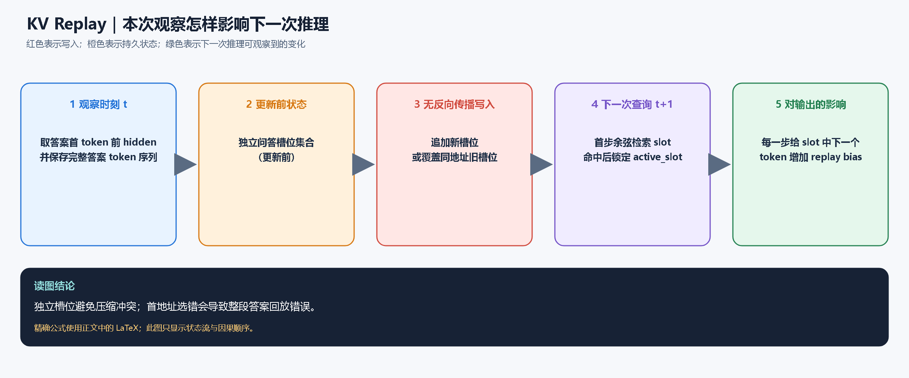
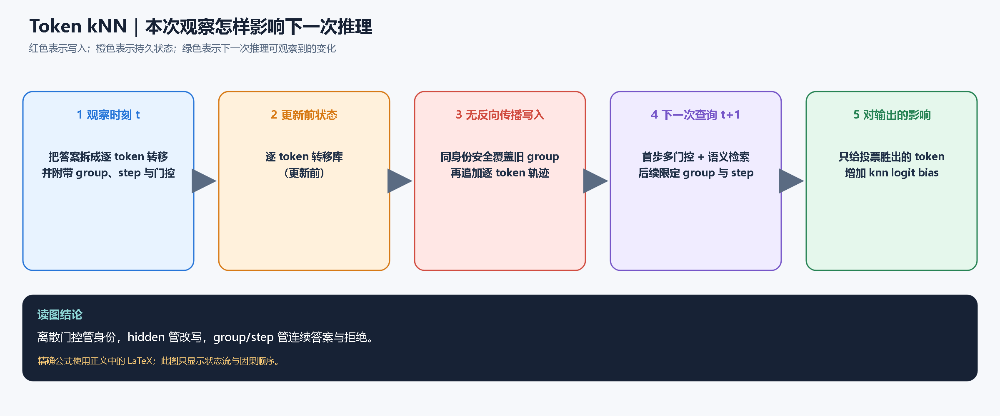

> **历史教师问答协议说明：** 本文的问答示例和成绩属于旧的人工 assistant 目标写入 / 回放实验，不能作为从 user 多轮对话形成记忆的结论。新实验仅观察 user 内容，并用独立进程评估；请以 [user 对话重新实验报告](user-dialogue-experiment-report.html) 为当前结论。

[← 返回交互实验台](../)

# 动态记忆如何在本次推理写入，并影响下一次推理

这篇文档只回答一个核心问题：**第 $t$ 次看到一条问答时，插件究竟改了什么；到了第 $t+1$ 次只有问题时，这个变化又怎样进入 Qwen 的计算并改变输出？**

如果希望把下面的静态说明按步骤播放，可使用 [动态记忆交互网页](../index.html)：八种方法均可自动播放、逐步前进，并同步显示状态动画、LaTeX 公式和下一 token logits 变化。

文中的公式全部使用 LaTeX。行内公式写作 `$x$`，独立公式写在 `$$...$$` 中；阅读器需要启用 MathJax 或 KaTeX。图片负责展示网络位置和状态流，图片下的正文负责解释因果关系，二者不是重复内容。

## 1. 先分清三个时间点

设冻结的 Qwen 主干参数为 $\theta$，可变插件状态为 $S_t$。项目不会修改 $\theta$，只会修改 $S_t$。

### 1.1 普通生成：只读，不写

普通问题 $x$ 到来时，模型输出为

$$
p(y\mid x,S_t)
=
\operatorname{softmax}\!\left(
f_{\theta}(x)+g(x;S_t)
\right),
$$

其中 $f_{\theta}$ 是冻结 Qwen 产生的基础 logits，$g$ 是插件从当前记忆状态读出的修正。默认情况下，普通 `generate()` 不改变 $S_t$。

### 1.2 观察问答：一次前向完成写入

当系统执行 `observe_pair(question, answer)` 时，问题和教师答案会一起经过一次冻结前向。插件取得局部 hidden、目标 token 或地址信息，然后直接执行

$$
S_{t+1}=U(S_t;x,y,r),
$$

其中 $U$ 是预先写死的局部更新规则，$r$ 是可选奖赏。这里没有损失反传，也没有优化器。

### 1.3 下一次生成：读到更新后的状态

新问题 $x'$ 到来时，基础模型仍是同一个 $f_{\theta}$，变化来自插件已经换成 $S_{t+1}$：

$$
p(y'\mid x',S_{t+1})
=
\operatorname{softmax}\!\left(
f_{\theta}(x')+g(x';S_{t+1})
\right).
$$

因此一次记忆的可观察影响是

$$
\Delta g(x')=g(x';S_{t+1})-g(x';S_t).
$$

后文每种方法都分别解释 $S_t$、$U$、$g$ 和 $\Delta g$ 是什么。

## 2. 共同数据流：更新发生在“推理系统”中，但不是每轮生成都写

观察阶段也只做前向推理，所以从运行形态看属于 inference-time update；但它是一个明确的**可写观察调用**，而不是让模型在每次自由生成后自动把自己的答案写回去。这样做是为了避免模型把幻觉继续巩固成记忆。

共同边界是：

$$
\nabla_{\theta}=0,
\qquad
\texttt{requires\_grad}(\theta)=\mathrm{False},
\qquad
\texttt{backward()}\ \text{从不调用}.
$$

插件状态则在 `torch.no_grad()` 中用 `add_`、`mul_` 或 `copy_` 原位更新。它会跨后续推理保留，也可单独保存成 Safetensors。

下面使用同一条事实说明八种方法：

> 问题：霁舟-17 的通行码是什么？  
> 教师答案：苍羽-92

## 3. Residual Hebbian：把共同活动写进层内快权重

更完整的网络位置见 [逐层网络图](diagrams/layerwise/01-residual-hebbian-network.png)，张量形状见 [状态与公式图](diagrams/layerwise/01-residual-hebbian-math.png)。

### 3.1 第 $t$ 次观察时写了什么

在选中的 Decoder Layer 输出处，先把 hidden $H$ 归一化并压到 $r$ 维：

$$
N=\frac{H}{\sqrt{\operatorname{mean}(H^2)+\varepsilon}},
\qquad
Z=\operatorname{norm}\!\left(\tanh(NE)\right),
$$

其中 $E\in\mathbb{R}^{d\times r}$ 是固定随机投影，不参与学习。把当前问答的局部活动压成两个平均向量：

$$
p=\operatorname{mean}_{B,T}(Z)\in\mathbb{R}^{r},
\qquad
s=\tanh\!\left(\operatorname{mean}_{B,T}(N)\right)\in\mathbb{R}^{d}.
$$

新奇度和有效步长为

$$
\nu=\operatorname{clip}\!\left(1-\cos(p,\tau_t),0,2\right),
\qquad
\gamma=\eta r_{\mathrm{reward}}\nu.
$$

快权重从 $W_t^{\mathrm{fast}}$ 变为

$$
W_{t+1}^{\mathrm{fast}}
=
\operatorname{clip}_{\mathrm{row}}
\left[
(1-\lambda)W_t^{\mathrm{fast}}+\gamma ps^{\top}
\right].
$$

外积 $ps^{\top}$ 的含义是：这次前向中同时出现的低秩模式 $p$ 与隐藏方向 $s$ 被建立连接。

### 3.2 第 $t+1$ 次推理怎样受到影响

新问题在同一层产生查询 code $z_q$。插件读出

$$
d_q=z_qW_{t+1}^{\mathrm{fast}},
\qquad
h'_q=h_q+\alpha d_q.
$$

忽略衰减和裁剪时，这次新写入单独带来的隐藏变化近似为

$$
\Delta h_q
\approx
\alpha\gamma(z_qp)s^{\top}.
$$

这条式子揭示了记忆如何跨推理生效：若新问题的 $z_q$ 与观察时的 $p$ 相似，内积 $z_qp$ 较大，旧活动方向 $s$ 就会被重新注入；若不相似，影响自然变小。

但 $s$ 只是整段活动方向，并没有说答案的第一个 token 必须是“苍”。所以它可以改变 hidden 和 logits，却不保证形成可解码的新事实。

## 4. Residual Oja：在 Hebbian 写入上加入自稳定项

更完整的网络位置见 [逐层网络图](diagrams/layerwise/02-residual-oja-network.png)，张量形状见 [状态与公式图](diagrams/layerwise/02-residual-oja-math.png)。

### 4.1 第 $t$ 次观察时写了什么

$p$、$s$、$\nu$ 和 $\gamma$ 的计算与 Hebbian 相同。区别是更新中多了一个依赖旧权重和突触后活动平方的抑制项：

$$
A_{\mathrm{Oja}}
=
ps^{\top}
-
W_t\operatorname{diag}(s\odot s),
$$

$$
W_{t+1}
=
\operatorname{clip}_{\mathrm{row}}
\left[(1-\lambda)W_t+\gamma A_{\mathrm{Oja}}\right].
$$

第一项建立相关性；第二项抑制已经很强、且当前输出活动又很大的连接，避免纯 Hebbian 一直累加。

### 4.2 第 $t+1$ 次推理怎样受到影响

读取公式仍然是

$$
h'_q=h_q+\alpha z_qW_{t+1}.
$$

因此 Oja 改变的是“保存后的权重有多稳定”，而不是“下一次如何读”。它能减轻数值发散和旧关联无限增长，却没有新增目标 token、事实身份或答案顺序。实验失败的核心原因因此仍与 Residual Hebbian 相同。

## 5. Vocab Hebbian：把局部相似度直接变成目标 token 的 logit

更完整的网络位置见 [逐层网络图](diagrams/layerwise/03-vocab-hebbian-network.png)，张量形状见 [状态与公式图](diagrams/layerwise/03-vocab-hebbian-math.png)。

### 5.1 第 $t$ 次观察时写了什么

对答案中每个 teacher-forced 位置，取当前位置之前的 key $k_i\in\mathbb{R}^{r}$ 和真实 next token $y_i$。令 $e_{y_i}\in\mathbb{R}^{V}$ 为该 token 的 one-hot 向量，则

$$
W_{t+1}
=
(1-\lambda)W_t
+
\eta r_{\mathrm{reward}}
\sum_{i\in\mathcal{A}} k_i e_{y_i}^{\top},
$$

其中 $\mathcal{A}$ 只包含 assistant 答案位置。对“苍羽-92”，写入大致是

$$
k_0\rightarrow \text{“苍”},\quad
k_1\rightarrow \text{“羽”},\quad
k_2\rightarrow \text{“-”},\quad
k_3\rightarrow \text{“92”}.
$$

### 5.2 第 $t+1$ 次推理怎样受到影响

LM Head 先给出基础 logits $\ell_{\mathrm{base}}$，插件再叠加

$$
\ell_{\mathrm{final}}
=
\ell_{\mathrm{base}}+\alpha k_qW_{t+1}.
$$

忽略衰减时，本次观察带来的新增部分是

$$
\Delta\ell_q
=
\alpha\eta r_{\mathrm{reward}}
\sum_{i\in\mathcal{A}}
(k_q^{\top}k_i)e_{y_i}^{\top}.
$$

所以只有与 $k_q$ 相似的历史 key 才会抬高其目标 token。这个机制已经能精确说“应该增强哪个词表项”。

失败点在于所有事实共享 $W\in\mathbb{R}^{r\times V}$。若许多答案都含有“-”、数字或相同句式，这些 token 列会聚合大量不同事实，最后产生公共吸引子并污染无关问题。

## 6. Balanced Vocab Hebbian：先抑制高频写入，再归一化读取

更完整的网络位置见 [逐层网络图](diagrams/layerwise/04-vocab-hebbian-balanced-network.png)，张量形状见 [状态与公式图](diagrams/layerwise/04-vocab-hebbian-balanced-math.png)。

### 6.1 第 $t$ 次观察时写了什么

设 token $y_i$ 此前已写入 $c_t(y_i)$ 次，则单次写入缩放为

$$
a_i=\frac{1}{\sqrt{c_t(y_i)+1}},
$$

$$
W_{t+1}
=
(1-\lambda)W_t
+
\eta r_{\mathrm{reward}}
\sum_{i\in\mathcal{A}}a_i k_i e_{y_i}^{\top}.
$$

高频 token 出现越多，之后每次写入越弱。

### 6.2 第 $t+1$ 次推理怎样受到影响

读取前对每个词表列做单位化：

$$
\widehat W_{:,y}
=
\frac{W_{:,y}}
{\max(\lVert W_{:,y}\rVert_2,\varepsilon)},
\qquad
\ell_{\mathrm{final}}
=
\ell_{\mathrm{base}}+\alpha k_q\widehat W.
$$

于是一个 token 不会只因为被写得多、列范数大就总是获胜。它改善的是**频率偏置**，没有把“霁舟-17 的羽”和另一事实里的“羽”拆成两个独立地址，因此只能缓解、不能消除混淆。

## 7. Vocab Delta：只写入当前映射尚未解释的误差

更完整的网络位置见 [逐层网络图](diagrams/layerwise/05-vocab-delta-network.png)，张量形状见 [状态与公式图](diagrams/layerwise/05-vocab-delta-math.png)。

### 7.1 第 $t$ 次观察时写了什么

把所有答案位置的 key 堆成 $K\in\mathbb{R}^{N\times r}$，目标 one-hot 堆成 $Y\in\mathbb{R}^{N\times V}$。旧快权重的当前预测为

$$
P_t=KW_t,
$$

局部输出误差为

$$
E_t=Y-P_t.
$$

闭式更新是

$$
W_{t+1}
=
(1-\lambda)W_t
+
\frac{\eta r_{\mathrm{reward}}}{N}K^{\top}E_t.
$$

误差 $E_t$ 不会沿 Qwen 向前传播；它只修正这个外接矩阵。

### 7.2 第 $t+1$ 次推理怎样受到影响

查询 $k_q$ 读出的新增 logits 近似为

$$
\Delta\ell_q
=
\frac{\alpha\eta r_{\mathrm{reward}}}{N}
k_qK^{\top}(Y-KW_t).
$$

$k_qK^{\top}$ 是查询与本次所有教师位置的相似度，因此修正会按相似度传播到下一次推理。相比 Hebbian，它不会盲目重复加强已经预测正确的内容；但所有映射仍挤在有限秩共享矩阵中，修正一个 key 仍可能覆盖邻近 key。

## 8. Vocab EMA：为每个 token 保存一个上下文原型

更完整的网络位置见 [逐层网络图](diagrams/layerwise/06-vocab-ema-network.png)，张量形状见 [状态与公式图](diagrams/layerwise/06-vocab-ema-math.png)。

### 8.1 第 $t$ 次观察时写了什么

对目标 token $y$，收集所有对应 key：

$$
\mathcal{K}_y=\{k_i\mid y_i=y\},
\qquad
\mu_y=\frac{1}{|\mathcal{K}_y|}\sum_{k_i\in\mathcal{K}_y}k_i.
$$

将均值归一化后，用动量 $m$ 更新该 token 的原型：

$$
\widehat p_y=c\frac{\mu_y}{\lVert\mu_y\rVert_2},
\qquad
p_{y,t+1}=mp_{y,t}+(1-m)r_{\mathrm{reward}}\widehat p_y.
$$

### 8.2 第 $t+1$ 次推理怎样受到影响

查询 key 对每个 token 原型打分：

$$
s_y(k_q)=k_q^{\top}p_{y,t+1},
\qquad
\ell_{\mathrm{final},y}
=
\ell_{\mathrm{base},y}+\alpha s_y(k_q).
$$

如果新问题的上下文像历史上生成 token $y$ 的平均上下文，它就获得额外 logit。问题是每个 token 只有一个原型：不同事实、不同答案位置和新旧版本都会被压成同一个均值，信息一旦平均便不能恢复。

## 9. KV Replay：首步找到独立槽位，后续按序回放答案

更完整的网络位置见 [逐层网络图](diagrams/layerwise/07-kv-replay-network.png)，张量形状见 [状态与公式图](diagrams/layerwise/07-kv-replay-math.png)。

### 9.1 第 $t$ 次观察时写了什么

设答案第一个 token 位于位置 $j_0$。取它前一个位置的 hidden 作为地址，并保存完整答案：

$$
k_i=\frac{h_{j_0-1}}{\lVert h_{j_0-1}\rVert_2},
\qquad
v_i=(y_0,y_1,\ldots,y_{m-1}).
$$

状态不再是共享映射，而是槽位集合：

$$
S_{t+1}=S_t\cup\{(k_i,v_i,m)\}.
$$

若新地址与已有地址的余弦相似度超过覆盖阈值，则覆盖该槽位；否则追加，容量满后按环形位置复用。

### 9.2 第 $t+1$ 次推理怎样受到影响

只在答案首 token 前检索：

$$
i^*=\arg\max_i q_0^{\top}k_i.
$$

若 $q_0^{\top}k_{i^*}\ge\tau$，系统锁定 `active_slot`。第 $j$ 个生成步对槽位中的目标 token 加偏置：

$$
\ell'_j(y)
=
\ell_j(y)
+
\beta\,\mathbf{1}\!\left[y=v_{i^*}[j]\right].
$$

因此第一次检索决定“使用哪条事实”，后续步骤不再重新选槽位。独立 value 避免了共享矩阵压缩，所以记忆率显著提升；但若首地址把“霁舟-99”误认成“霁舟-17”，整段答案都会稳定地回放错。

## 10. Token kNN：把事实拆成有身份、有顺序的逐 token 转移

更完整的网络位置见 [逐层网络图](diagrams/layerwise/08-token-knn-network.png)，张量形状见 [状态与公式图](diagrams/layerwise/08-token-knn-math.png)。视觉版完整路径见 [Qwen3-VL 网络图](diagrams/layerwise/09-token-knn-vlm-network.png)。

### 10.1 第 $t$ 次观察时写了什么

答案被拆成一组 transition：

$$
\mathcal{T}_g
=
\left\{
(k_j,y_j,g,j,e,c,\phi(x))
\right\}_{j=0}^{m-1},
$$

其中 $g$ 是事实组，$j$ 是答案步号，$e$ 是实体标签，$c$ 是可选视觉签名，$\phi(x)$ 是 prompt token 指纹。每个 key 对应“在这个上下文下，下一个 token 是什么”。

覆盖旧事实前，不再只比较 hidden，而先要求身份和上下文一致：

$$
\operatorname{same}(i,q)
=
\mathbf{1}[e_i=e_q]
\cdot
\mathbf{1}[c_i^{\top}c_q\ge\tau_c]
\cdot
\mathbf{1}[k_i^{\top}k_q\ge\tau_{\mathrm{overwrite}}].
$$

只有 `same=1` 的旧 group 才会被替换，避免相似模板误删其他实体。

### 10.2 第 $t+1$ 次推理怎样受到影响

首步候选集合同时满足起始位置、实体、词法和视觉门控：

$$
\mathcal{C}_0
=
\left\{
i\ \middle|\
\operatorname{active}_i
\land \operatorname{start}_i
\land e_i=e_q
\land G_{\mathrm{lex}}(i,q)
\land G_{\mathrm{ctx}}(i,q)
\right\}.
$$

再在候选内做语义检索：

$$
i^*=\arg\max_{i\in\mathcal{C}_0}q_0^{\top}k_i.
$$

若最高分低于 $\tau_{\mathrm{start}}$，插件直接返回基础 logits；命中后锁定 $g^*=g_{i^*}$。后续第 $j$ 步只允许同组同位置候选：

$$
\mathcal{C}_j
=
\{i\mid g_i=g^*,\ \operatorname{step}_i=j\}.
$$

对 top-$k$ 邻居按相似度投票：

$$
\operatorname{vote}_j(y)
=
\sum_{i\in\operatorname{TopK}(\mathcal{C}_j)}
w_i\mathbf{1}[y_i=y],
\qquad
w_i=\operatorname{softmax}\!\left(\frac{q_j^{\top}k_i}{T}\right).
$$

获胜 token $y_j^*$ 的 logit 被增加：

$$
\ell'_j(y)
=
\ell_j(y)+\beta\mathbf{1}[y=y_j^*].
$$

这使三种职责分离：离散门控判断“是不是同一身份”，连续 hidden 处理语义改写，group/step 保证多 token 答案不串位。任何首步门控失败时，$\Delta\ell=0$，所以未学习 benchmark 可以保持原样。

## 11. 八种方法的因果差异

| 方法 | 可变状态 $S_t$ | 第 $t$ 次写入的监督 | 第 $t+1$ 次从哪里生效 | 主要失败边界 |
|---|---|---|---|---|
| Residual Hebbian | 每层 $W^{\mathrm{fast}}$ | 层内共同活动 | Decoder hidden 残差 | 没有目标 token |
| Residual Oja | 每层 $W^{\mathrm{oja}}$ | 共同活动 + 稳定项 | Decoder hidden 残差 | 稳定但仍无目标 |
| Vocab Hebbian | $r\times V$ 矩阵 | key 与目标 token | LM Head logits | 共享列串扰 |
| Balanced Hebbian | 矩阵 + token 计数 | 频率平衡后的目标 token | 归一化动态 logits | 仍无事实身份 |
| Vocab Delta | $r\times V$ 矩阵 | 局部输出误差 | LM Head logits | 有限秩覆盖 |
| Vocab EMA | 每 token 原型 | key 均值 | 原型相似度 logits | 平均掉事实与顺序 |
| KV Replay | 独立问答槽位 | 完整答案 token 序列 | 首步检索后整段回放 | 首地址误触发 |
| Token kNN | 带 group/step/gate 的转移 | 每一步目标 token | 多门控检索 + 逐步偏置 | 门控泛化与容量成本 |

真正决定“是否记住”的不是参数有没有变化，而是下面四件事是否同时成立：

$$
\boxed{
\text{目标可写}
\;\land\;
\text{地址可区分}
\;\land\;
\text{序列可连续}
\;\land\;
\text{陌生输入可拒绝}
}
$$

Residual 方法缺少目标，Vocab 方法缺少事实身份，KV Replay 缺少足够精确的首地址边界；Token kNN 之所以在当前合成实验中最好，是因为它显式补齐了这四个条件，而不是因为 kNN 本身具有某种神奇的学习能力。

## 12. 怎样确认不是偶然命中

对任一方法，至少要分别测量：

1. **精确回忆**：原问题是否输出随机生成的目标答案；
2. **改写回忆**：同一事实换一种问法是否仍命中；
3. **近邻拒绝**：只改实体编号时是否错误触发；
4. **覆盖更新**：同一问题写入新答案后，旧答案是否消失；
5. **延迟保持**：继续写入更多事实后，早期事实是否遗忘；
6. **无关能力回归**：开源 benchmark 的答案和分数是否变化；
7. **跨会话恢复**：保存插件、重启模型、重新加载后是否仍能回忆。

如果只检查“观察后 logits 发生了变化”，最多证明 $S_{t+1}\ne S_t$；只有上述正例、改写、负例、覆盖和回归同时成立，才足以说明变化确实构成了可控记忆。

