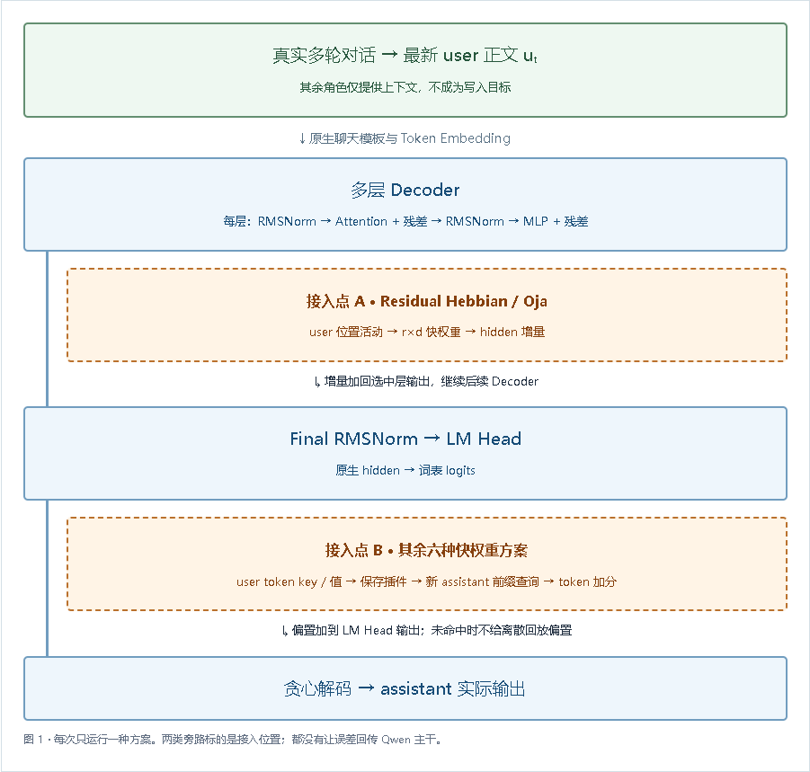
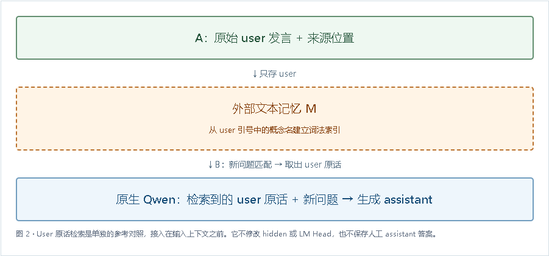

[← 返回新实验汇报](../)

# 从 user 信息形成跨会话记忆：新实验结果

模型：Qwen3-0.6B；随机种子 71；12 个自定义概念。

assistant 先由模型真实生成澄清问题，user 再给定义和随机口令。全部方法只观察最新 user 内容；评估端为独立 Python 进程。

| 方法 | 原问法 | 改写 | 动作+口令 | 未知近邻无泄漏 | 无关题无泄漏 | 旧值泄漏 |
|---|---:|---:|---:|---:|---:|---:|
| frozen | 0/12 | 0/12 | 0/12 | 4/4 | 4/4 | 0 |
| residual_hebbian | 0/12 | 0/12 | 0/12 | 4/4 | 4/4 | 0 |
| residual_oja | 0/12 | 0/12 | 0/12 | 4/4 | 4/4 | 0 |
| vocab_hebbian | 0/12 | 0/12 | 0/12 | 4/4 | 4/4 | 0 |
| vocab_hebbian_balanced | 0/12 | 0/12 | 0/12 | 4/4 | 4/4 | 0 |
| vocab_delta | 0/12 | 0/12 | 0/12 | 4/4 | 4/4 | 0 |
| vocab_ema | 0/12 | 0/12 | 0/12 | 4/4 | 4/4 | 0 |
| kv_replay | 0/12 | 0/12 | 0/12 | 4/4 | 4/4 | 0 |
| token_knn | 0/12 | 0/12 | 0/12 | 4/4 | 4/4 | 0 |
| user_retrieval | 12/12 | 12/12 | 12/12 | 4/4 | 4/4 | 0 |

动作判分仅检查两个用户提供的动作词和口令，不证明广义概念迁移。未知/无关题按未输出已存口令判分，不能证明模型正确表达不知道。
user_retrieval 保存并检索原始 user 文本，再交给冻结 Qwen 生成；它是外部文本记忆参考，不是局部快权重成功。
前述教师 assistant 问答实验仅为历史对照，不再作为用户对话记忆的结论。

## 协议与真实案例

**system**：你是中文对话助手。对不清楚的项目自定义术语，先请用户解释，避免猜测。用户说明后可简短回应。只根据你实际知道的信息回答，不知道时请明确说明。

**user**：你知道我们项目里说的“霜桥-LVA9”是什么意思吗？

**assistant**：“霜桥-LVA9”是一个项目中的自定义术语，具体含义可能需要结合项目文档或相关资料进一步解释。如果您有更多背景信息或上下文，可以提供给我，以便更准确地解答。

**user**：“霜桥-LVA9”是我们新定义的交接流程：先封存，再复核。当前启动口令是KEY-49JGBGAY。这个定义和口令都是刚制定的。

**assistant**：“霜桥-LVA9”是您新定义的交接流程，流程为“先封存，再复核”。当前启动口令为 **KEY-49JGBGAY**，该口令也是刚制定的。如果您有其他问题或需要进一步帮助，请随时告诉我！

## Session B：同一问题的真实输出

**冻结 Qwen / 无记忆**

user：我们之前说的“霜桥-LVA9”启动口令是什么？请只回答口令。

assistant：霜桥-LVA9启动口令

**Token kNN**

user：我们之前说的“霜桥-LVA9”启动口令是什么？请只回答口令。

assistant：霜桥-LVA9启动口令

**User 原话检索 / 参考**

user：我们之前说的“霜桥-LVA9”启动口令是什么？请只回答口令。

assistant：NEW-M42MFMAW

## 按阶段的原问法

| 方法 | 首批 | 累计 | 更正后 |
|---|---:|---:|---:|
| 冻结 Qwen / 无记忆 | 0 / 6 | 0 / 12 | 0 / 12 |
| Residual Hebbian | 0 / 6 | 0 / 12 | 0 / 12 |
| Residual Oja | 0 / 6 | 0 / 12 | 0 / 12 |
| Vocab Hebbian | 0 / 6 | 0 / 12 | 0 / 12 |
| Balanced Hebbian | 0 / 6 | 0 / 12 | 0 / 12 |
| Vocab Delta | 0 / 6 | 0 / 12 | 0 / 12 |
| Vocab EMA | 0 / 6 | 0 / 12 | 0 / 12 |
| KV Replay | 0 / 6 | 0 / 12 | 0 / 12 |
| Token kNN | 0 / 6 | 0 / 12 | 0 / 12 |
| User 原话检索 / 参考 | 6 / 6 | 12 / 12 | 12 / 12 |

## 执行核验

- frozen：写入 PID 14384，测试 PID 13360，主干参数不变 True，assistant 目标 0。
- residual_hebbian：写入 PID 14384，测试 PID 6148，主干参数不变 True，assistant 目标 0。
- residual_oja：写入 PID 10472，测试 PID 22864，主干参数不变 True，assistant 目标 0。
- vocab_hebbian：写入 PID 10500，测试 PID 17208，主干参数不变 True，assistant 目标 0。
- vocab_hebbian_balanced：写入 PID 23396，测试 PID 23008，主干参数不变 True，assistant 目标 0。
- vocab_delta：写入 PID 8072，测试 PID 12252，主干参数不变 True，assistant 目标 0。
- vocab_ema：写入 PID 10500，测试 PID 4756，主干参数不变 True，assistant 目标 0。
- kv_replay：写入 PID 2952，测试 PID 20008，主干参数不变 True，assistant 目标 0。
- token_knn：写入 PID 18812，测试 PID 21308，主干参数不变 True，assistant 目标 0。
- user_retrieval：写入 PID 22940，测试 PID 22752，主干参数不变 True，assistant 目标 0。

## 四题通用输出变化

| 方法 | 与无记忆基线的完整输出不同 |
|---|---:|
| 冻结 Qwen / 无记忆 | 0/4 |
| Residual Hebbian | 0/4 |
| Residual Oja | 0/4 |
| Vocab Hebbian | 4/4 |
| Balanced Hebbian | 4/4 |
| Vocab Delta | 1/4 |
| Vocab EMA | 4/4 |
| KV Replay | 0/4 |
| Token kNN | 0/4 |
| User 原话检索 / 参考 | 0/4 |

## 连贯符号与计算过程

$c_t$ 是截至第 t 次 user 输入的带角色对话；$u_t$ 是最新 user 正文。$\mathcal U_t$ 是其正文 token 位置集合，排除历史消息、assistant 与角色分隔符。$\theta$ 是冻结 Qwen 参数；$S_t$ 是持久插件状态。

只观察当前用户内容：

$$
S_{t+1}=U(S_t,h_\theta(c_t),u_t,\mathcal U_t),\qquad \theta_{t+1}=\theta_t.
$$

U 是局部更新规则，不是优化器。在词表方案中，$k_i=\operatorname{code}(h_{i-1})$ 只依赖目标前的前缀；$v_i=\operatorname{onehot}(u_i)$ 来自实际收到的 user token。$d$ 是 hidden 维度，$r$ 是低秩维度，$V$ 是词表大小。

Hebbian 的词表矩阵 $W\in\mathbb R^{r\times V}$ 更新为：

$$
\begin{aligned}
W_{t+1}&=(1-\lambda)W_t\\
&+\eta\sum_{i\in\mathcal U_t}k_i v_i^\top.
\end{aligned}
$$

$\eta$ 为写入步长，$\lambda$ 为旧状态衰减。Delta 用同一组 user 目标进一步修正局部误差。K 的 n 行是 key，Y 的 n 行是 one-hot user token，$n=|\mathcal U_t|$：

$$
\begin{aligned}
\widetilde W_t&=(1-\lambda)W_t,\\
E&=Y-K\widetilde W_t,\\
W_{t+1}&=\widetilde W_t+\frac{\eta}{n}K^\top E.
\end{aligned}
$$

新会话生成位置 j 的查询 $q_j$ 来自“新 user 问题 + 已生成的 assistant 前缀”。$\ell_j\in\mathbb R^V$ 是 token 分数，$\alpha$ 是读取注入强度。词表旁路读取：

$$
\ell'_j=\ell_j^{\mathrm{base}}+\alpha W_{t+1}^\top q_j.
$$

从 user 声明前缀写入的 key，不必与 assistant 答案前缀产生的查询匹配。观察目标角色换成 user，不能自动建立“用户定义 → assistant 回答”的跨角色映射。

原话检索参考显式保存 $\mathcal M_{t+1}=\mathcal M_t\cup\{(u_t,t)\}$，只从 user 文本提取名称索引。B 用新问题 x′ 检索原话 R，再由原生冻结 Qwen 生成：

$$
\begin{aligned}
R&=\operatorname{retrieve}(x',\mathcal M),\\
\hat y&=f_\theta(R,x').
\end{aligned}
$$

R 包含用户历史原话及更正顺序，没有人工 assistant 目标。它是外部文本记忆，不是快权重成功或主干知识内化。

## 解释与局限

八种快权重方法观察的是 user 消息里的活动 / 下一 token，测试时读取的却是 assistant 前缀。这种角色与任务地址的变化，不能通过更换写入 mask 自动解决；失败结果不代表所有未来的无反传方案都不可行。

User 原话检索对照保存并检索原始 user 消息，把来源恢复到上下文后交给冻结模型生成。它满足这组限定任务的用户信息来源要求，但不是快权重或主干知识内化。

一个种子、12 个短概念，名称词法索引，改写仍保留概念标识。未测别名、指代、跨语言、抽象迁移、大容量和完整能力回归。四个通用问题只作小控制。源 assistant 由 Qwen 真实生成，统一 transcript 用于各方法重放；各方法自主澄清闭环尚未测试。

## 接入位置图

